
<b>200+</b> free projects &middot; <b>1,000,000+</b> downloads

Hi! I&#39;m Matt. <a href="https://portfolio.getparkerai.com/">More about what I do &#8594;</a>

<!-- GENERATED PROFILE: edit data/profile-catalog.json or data/showcase.json, then run scripts/sync-profile.ps1 -Write. Do not hand-edit this file. -->

## Hush patch bundles for Android

Better versions of the apps you already use. Each bundle takes the ads and clutter out. Install Morphe Manager, tap Add to Morphe next to your app, and new releases show up on their own. <a href="https://morphe.software/">Get Morphe Manager &#8594;</a>

<table width="100%">
<tr>
<td width="300" valign="top">
 <b>Facebook</b> 
<a href="https://github.com/SysAdminDoc/Hushfacebook">Hush&shy;facebook</a> 
 
</td>
<td width="300" valign="top">
 <b>Instagram</b> 
<a href="https://github.com/SysAdminDoc/HushGram">Hush&shy;Gram</a> 
 
</td>
<td width="300" valign="top">
 <b>Messenger</b> 
<a href="https://github.com/SysAdminDoc/HushMessenger">Hush&shy;Messenger</a> 
 
</td>
</tr>
<tr>
<td width="300" valign="top">
 <b>PineDrama</b> 
<a href="https://github.com/SysAdminDoc/HushPine">Hush&shy;Pine</a> 
 
</td>
<td width="300" valign="top">
 <b>Pinterest</b> 
<a href="https://github.com/SysAdminDoc/HushPinterest">Hush&shy;Pinterest</a> 
 
</td>
<td width="300" valign="top">
 <b>Telegram</b> 
<a href="https://github.com/SysAdminDoc/HushTelegram">Hush&shy;Telegram</a> 
 
</td>
</tr>
<tr>
<td width="300" valign="top">
 <b>Threads</b> 
<a href="https://github.com/SysAdminDoc/HushThreads">Hush&shy;Threads</a> 
 
</td>
<td width="300" valign="top">
 <b>TikTok</b> 
<a href="https://github.com/SysAdminDoc/hushfeed">Hush&shy;feed</a> 
 
</td>
<td width="300" valign="top">
 <b>Tumblr</b> 
<a href="https://github.com/SysAdminDoc/HushTumblr">Hush&shy;Tumblr</a> 
 
</td>
</tr>
</table>

## My other apps

The ones people download most, and a few I'm proudest of.

<table>
<tr>
<td width="50%" valign="top">
<a href="https://github.com/SysAdminDoc/CallShield">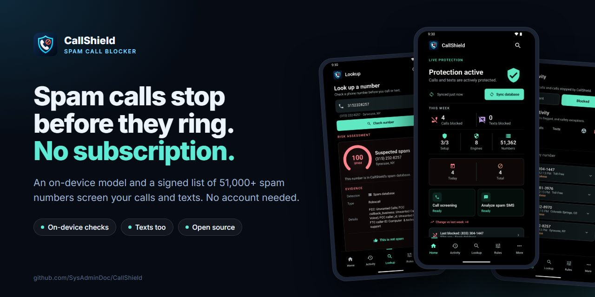</a>

<b><a href="https://github.com/SysAdminDoc/CallShield">CallShield</a></b> &middot; Android &middot; &#11088;81 &middot; 4,000+ downloads Blocks spam calls and flags spam texts with an on-device model and a signed database of 51,000+ numbers. No API keys and no subscription.

 

</td>
<td width="50%" valign="top">
<a href="https://github.com/SysAdminDoc/OpenLumen">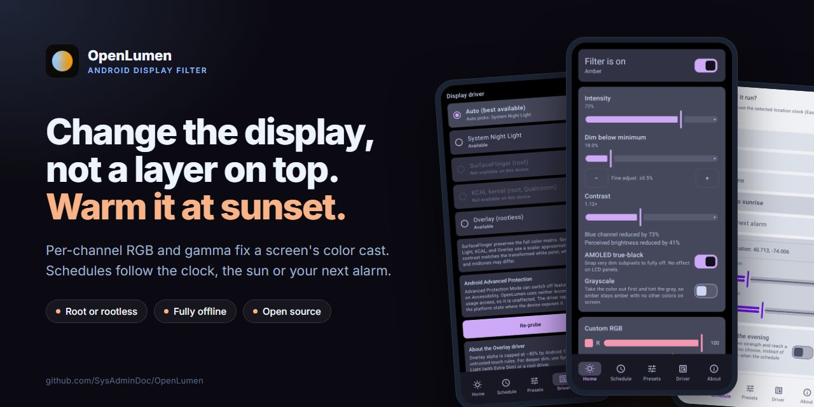</a>

<b><a href="https://github.com/SysAdminDoc/OpenLumen">OpenLumen</a></b> &middot; Android &middot; &#11088;19 &middot; 1,400+ downloads A screen color filter that changes the display itself instead of painting a layer on top. Warm the screen on a schedule or fix a panel&#39;s color cast, fully offline.

 

</td>
</tr>
<tr>
<td width="50%" valign="top">
<a href="https://github.com/SysAdminDoc/SwiftFloris">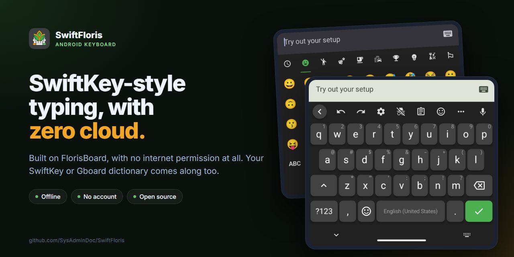</a>

<b><a href="https://github.com/SysAdminDoc/SwiftFloris">SwiftFloris</a></b> &middot; Android &middot; &#11088;38 &middot; 1,300+ downloads A SwiftKey-style keyboard built on FlorisBoard, with no internet permission at all. Import your SwiftKey or Gboard dictionary and it all stays on your phone.

 

</td>
<td width="50%" valign="top">
<a href="https://github.com/SysAdminDoc/RcloneBrowserNG">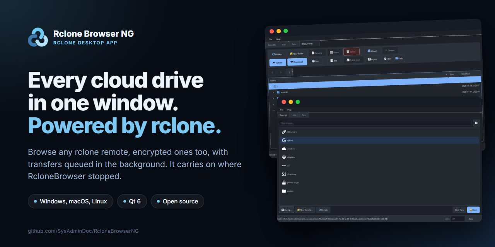</a>

<b><a href="https://github.com/SysAdminDoc/RcloneBrowserNG">Rclone Browser NG</a></b> &middot; Windows, macOS, Linux &middot; &#11088;20 A desktop app for rclone that picks up where the abandoned RcloneBrowser left off. Browse any remote, encrypted ones included, while transfers run in the background.

</td>
</tr>
<tr>
<td width="50%" valign="top">
<a href="https://github.com/SysAdminDoc/AppManagerNG">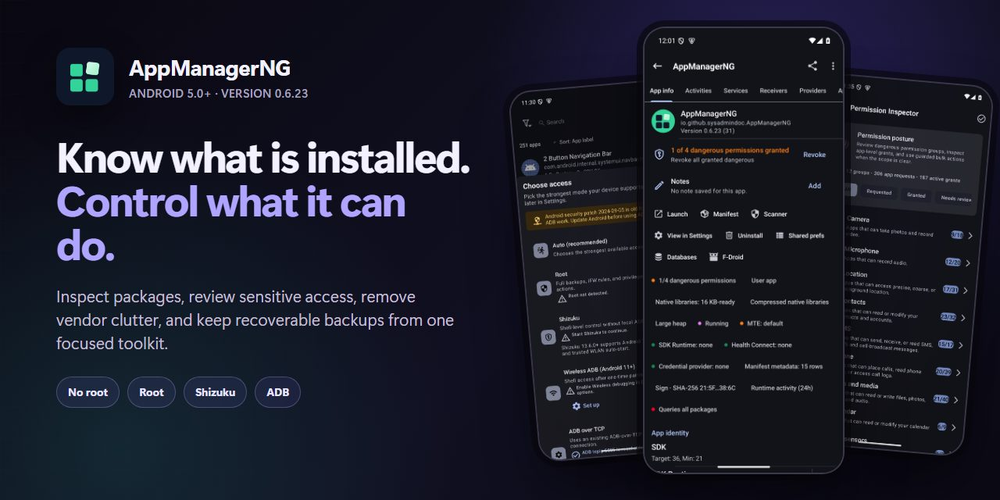</a>

<b><a href="https://github.com/SysAdminDoc/AppManagerNG">AppManagerNG</a></b> &middot; Android &middot; &#11088;201 &middot; 13,000+ downloads See every app on your phone and what it can reach. Freeze or remove the bloat and back up the rest, with or without root.

 

</td>
<td width="50%" valign="top">
<a href="https://github.com/SysAdminDoc/SnapCrop">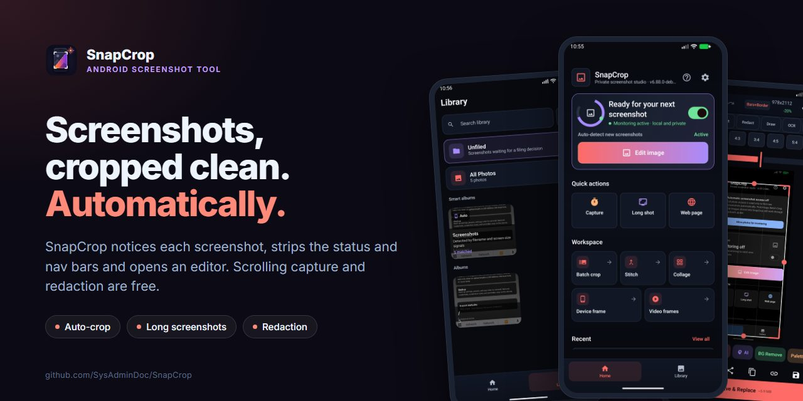</a>

<b><a href="https://github.com/SysAdminDoc/SnapCrop">SnapCrop</a></b> &middot; Android &middot; &#11088;14 Catches each screenshot as you take it and opens it in an editor with the status and nav bars already cropped off. Scrolling capture and automatic redaction of sensitive text are free.

 

</td>
</tr>
<tr>
<td width="50%" valign="top">
<a href="https://github.com/SysAdminDoc/HushFacebookWeb">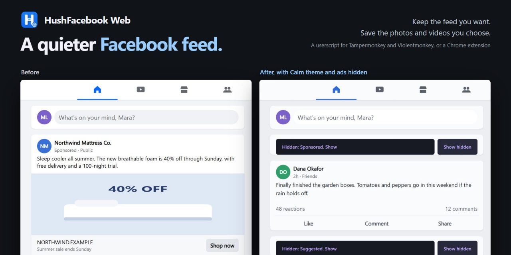</a>

<b><a href="https://github.com/SysAdminDoc/HushFacebookWeb">HushFacebook Web</a></b> &middot; Browser &middot; &#11088;47 &middot; 3,000+ downloads Takes ads and suggested posts out of Facebook in a desktop browser, and adds downloads and privacy switches. Runs as a userscript or a Chrome extension.

</td>
<td width="50%" valign="top">
<a href="https://github.com/SysAdminDoc/ZeusWatch">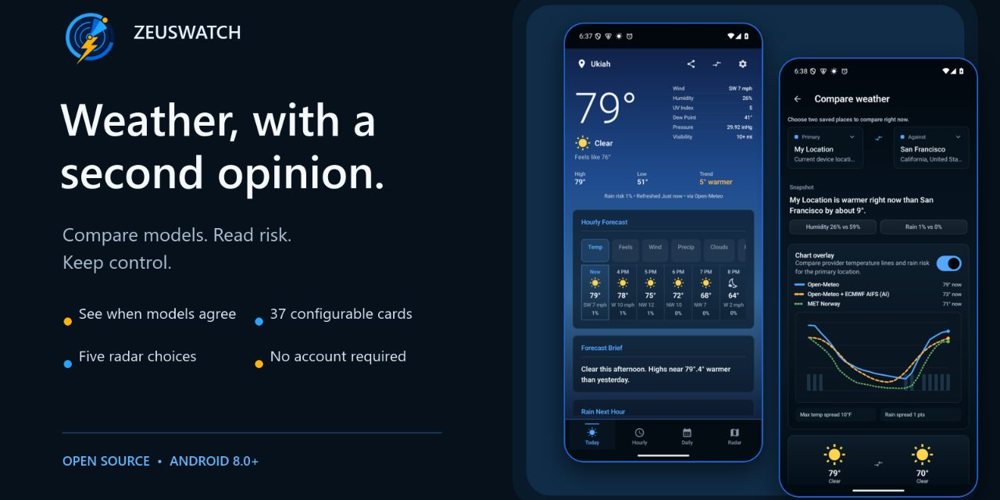</a>

<b><a href="https://github.com/SysAdminDoc/ZeusWatch">ZeusWatch</a></b> &middot; Android &middot; &#11088;15 &middot; 1,300+ downloads Weather with a second opinion. Put forecast providers side by side to see where the models disagree, then keep the sources you trust. No account needed.

 

</td>
</tr>
<tr>
<td width="50%" valign="top">
<a href="https://github.com/SysAdminDoc/AlarmClockXtreme">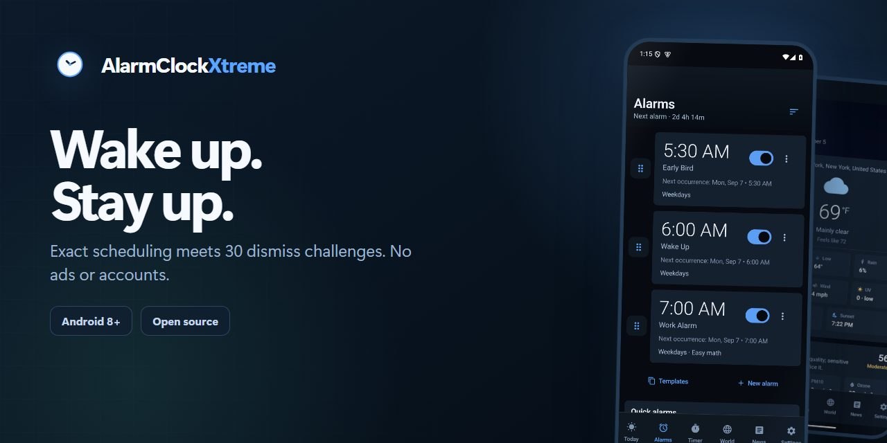</a>

<b><a href="https://github.com/SysAdminDoc/AlarmClockXtreme">AlarmClockXtreme</a></b> &middot; Android &middot; &#11088;50 &middot; 2,000+ downloads An alarm clock for heavy sleepers. Exact scheduling and 30 dismiss challenges get you up and keep you up, with no ads and no account.

 

</td>
<td width="50%" valign="top">
<a href="https://github.com/SysAdminDoc/OpenTasker">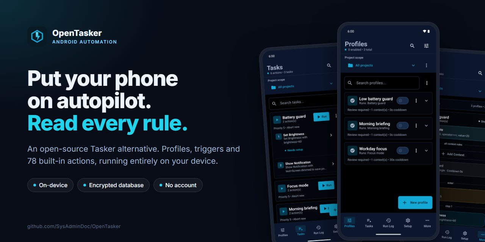</a>

<b><a href="https://github.com/SysAdminDoc/OpenTasker">OpenTasker</a></b> &middot; Android &middot; &#11088;213 &middot; 14,000+ downloads Phone automation in the spirit of Tasker, fully open source. Rules you can read at a glance and 78 built-in actions, all running on your phone.

 

</td>
</tr>
<tr>
<td width="50%" valign="top">
<a href="https://github.com/SysAdminDoc/OpenNetLimit">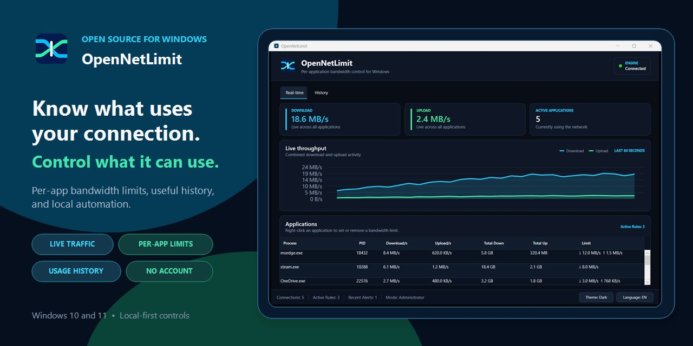</a>

<b><a href="https://github.com/SysAdminDoc/OpenNetLimit">OpenNetLimit</a></b> &middot; Windows &middot; &#11088;28 &middot; 1,100+ downloads See which apps are using your connection, then cap the ones that hog it. Per-app limits, traffic history, quotas and schedules on Windows.

</td>
<td width="50%"></td>
</tr>
</table>

## Pick your problem

Start from the job you need done.

| If you want to... | Try this |
|:------------------|:---------|
| Stop spam calls and texts | [**CallShield**](https://github.com/SysAdminDoc/CallShield) &#11088;81  |
| Put my phone on autopilot without a cloud account | [**OpenTasker**](https://github.com/SysAdminDoc/OpenTasker) &#11088;213  |
| Block ads on my phone, no root needed | [**HostShield**](https://github.com/SysAdminDoc/HostShield) &#11088;34  |
| Clear out the apps my phone came with | [**AppManagerNG**](https://github.com/SysAdminDoc/AppManagerNG) &#11088;201  |
| Uninstall a program and its leftovers | [**DeepPurge**](https://github.com/SysAdminDoc/DeepPurge) &#11088;31  |
| Fix a Windows Update that's stuck | [**WURepair**](https://github.com/SysAdminDoc/WURepair) &#11088;6  |
| See which app is eating my bandwidth, and cap it | [**OpenNetLimit**](https://github.com/SysAdminDoc/OpenNetLimit) &#11088;28  |
| Resize a partition and see the plan first | [**PartitionPilot**](https://github.com/SysAdminDoc/PartitionPilot) &#11088;7  |
| Change monitor brightness and inputs from Windows | [**MonitorControl**](https://github.com/SysAdminDoc/MonitorControl) &#11088;9  |
| Get burned-in subtitles out of a video | [**VideoSubtitleRemover**](https://github.com/SysAdminDoc/VideoSubtitleRemover) &#11088;114  |
| Make desktop YouTube work my way | [**Astra-Deck**](https://github.com/SysAdminDoc/Astra-Deck) &#11088;30  |
| Edit a photo without installing anything | [**Openshop**](https://github.com/SysAdminDoc/Openshop) &#11088;28  |

## Browse everything

Every public project, grouped by where it runs. Tap a shelf to open it, or [search them all](https://portfolio.getparkerai.com/) with filters.

<b>&#128421;&#65039; Windows and desktop apps</b> &middot; 59 projects

 

Installers, portable builds and desktop apps for your PC.

- [**win11-nvme-driver-patcher**](https://github.com/SysAdminDoc/win11-nvme-driver-patcher) &#11088;86 &middot; GUI to enable Windows Server 2025 NVMe driver on Win11 
- [**OpenCut**](https://github.com/SysAdminDoc/OpenCut) &#11088;70 &middot; AI-powered video editing automation for Premiere Pro. Caption generation, audio processing, VFX 
- [**DeepPurge**](https://github.com/SysAdminDoc/DeepPurge) &#11088;31 &middot; Thorough Windows uninstaller. Removes programs completely, hunts down every leftover 
- [**OpenNetLimit**](https://github.com/SysAdminDoc/OpenNetLimit) &#11088;28 &middot; Per-application bandwidth limiter and network monitor for Windows 
- [**RcloneBrowserNG**](https://github.com/SysAdminDoc/RcloneBrowserNG) &#11088;20 &middot; Modern rclone GUI. File browser, transfer manager, mount handler. Qt/C++ cross-platform desktop app. Community continuation of RcloneBrowser 
- [**project-nomad-desktop**](https://github.com/SysAdminDoc/project-nomad-desktop) &#11088;17 &middot; Offline survival command center. Maps, AI chat, situation room, NukeMap, supply tracking 
- [**MSStoreHelper**](https://github.com/SysAdminDoc/MSStoreHelper) &#11088;13 &middot; Install Microsoft Store apps without the Store 
- [**SlunderStudio**](https://github.com/SysAdminDoc/SlunderStudio) &#11088;13 &middot; Offline AI music generation suite. Song creation, lyrics, MIDI, vocals, stem separation, mastering 
- [**SunoJump**](https://github.com/SysAdminDoc/SunoJump) &#11088;13 &middot; Audio fingerprint masking for Suno AI. 10-pass pipeline, PyQt6 GUI, batch processing 
- [**UniversalConverterX**](https://github.com/SysAdminDoc/UniversalConverterX) &#11088;13 &middot; Native Windows file converter with context menu integration. 1000+ formats 
- [**Bookmark-Organizer-Pro**](https://github.com/SysAdminDoc/Bookmark-Organizer-Pro) &#11088;11 &middot; AI-powered bookmark manager and categorizer 
- [**Devicer**](https://github.com/SysAdminDoc/Devicer) &#11088;7 &middot; Unified Windows toolkit for rooted Android. Identify, ROM search, partition backup, boot.img patch, flashing 
- [**FaceSlim**](https://github.com/SysAdminDoc/FaceSlim) &#11088;7 &middot; AI face slimming, reshaping, and beautification with real-time preview and GPU acceleration 
- [**LocalChromeStore**](https://github.com/SysAdminDoc/LocalChromeStore) &#11088;7 &middot; Personal Chromium extension store sourced from GitHub releases. One-click install/uninstall 
- [**PartitionPilot**](https://github.com/SysAdminDoc/PartitionPilot) &#11088;7 &middot; Windows disk partition manager. WPF disk map, SMART health, maintenance, and image workflows 
- [**AstraDownloader**](https://github.com/SysAdminDoc/AstraDownloader) &#11088;6 &middot; Desktop video downloader for Windows that also serves the Astra Deck extension locally 
- [**LocalDesktopStore**](https://github.com/SysAdminDoc/LocalDesktopStore) &#11088;6 &middot; Private catalog for Windows desktop apps. MSI/Inno/NSIS/ZIP from GitHub releases 
- [**AI-Model-Compass**](https://github.com/SysAdminDoc/AI-Model-Compass) &#11088;4 &middot; Discover, download, and run local AI models tailored to your hardware 
- [**AndroidEmulatorPlus**](https://github.com/SysAdminDoc/AndroidEmulatorPlus) &#11088;4 &middot; Install Android SDK, manage AVDs, root with Magisk, migrate apps 
- [**AppList**](https://github.com/SysAdminDoc/AppList) &#11088;4 &middot; Scan, catalog, and export all installed applications 
- [**ExplorerTweaks**](https://github.com/SysAdminDoc/ExplorerTweaks) &#11088;4 &middot; GUI for toggling 50+ Windows File Explorer registry settings with live preview 
- [**ImgConverter**](https://github.com/SysAdminDoc/ImgConverter) &#11088;4 &middot; Universal image batch converter (PyQt6 GUI + CLI) with metadata, ICC, and HDR fidelity 
- [**qBittorrent-Vanced**](https://github.com/SysAdminDoc/qBittorrent-Vanced) &#11088;4 &middot; Customized BitTorrent client with dark theme Upstream: [c0re100/qBittorrent-Enhanced-Edition](https://github.com/c0re100/qBittorrent-Enhanced-Edition); License: GPL-2.0-or-later / GPL-3.0-or-later assets 
- [**QuickFind**](https://github.com/SysAdminDoc/QuickFind) &#11088;4 &middot; Lightning-fast file search for Windows. Reads NTFS MFT directly 
- [**FileOrganizer**](https://github.com/SysAdminDoc/FileOrganizer) &#11088;3 &middot; AI-powered desktop tool for classifying and organizing design asset folders 
- [**OpenRadar**](https://github.com/SysAdminDoc/OpenRadar) &#11088;3 &middot; Desktop weather radar for Windows. Decodes NEXRAD Level II, MRMS, GOES and GFS locally in Rust 
- [**PhoneFork**](https://github.com/SysAdminDoc/PhoneFork) &#11088;3 &middot; Dual-Samsung Android migration tool for Windows. Apps, media, settings, Wi-Fi, roles, and debloat profiles 
- [**PromptCompanion**](https://github.com/SysAdminDoc/PromptCompanion) &#11088;3 &middot; A curated, searchable, offline library of the best AI prompts 
- [**PyShop**](https://github.com/SysAdminDoc/PyShop) &#11088;3 &middot; Open source Photoshop alternative 
- [**REDplusplus**](https://github.com/SysAdminDoc/REDplusplus) &#11088;3 &middot; RED++. Remove Empty Directories. Find, display, and delete empty directories recursively with custom filter rules 
- [**UniFile**](https://github.com/SysAdminDoc/UniFile) &#11088;3 &middot; AI-powered unified file organization. 5 engines, tag-based library, LLM integration 
- [**Cataclysm**](https://github.com/SysAdminDoc/Cataclysm) &#11088;2 &middot; 3D-globe desktop simulator for tsunamis from asteroid impacts, nuclear bursts, earthquakes, and landslides 
- [**FrameSnap**](https://github.com/SysAdminDoc/FrameSnap) &#11088;2 &middot; Browse MP4 videos, mark frames visually, and export precise screenshots 
- [**GitForge**](https://github.com/SysAdminDoc/GitForge) &#11088;2 &middot; Full GitHub repo manager. Clone, sync, diff, manage 
- [**HostsFileGet**](https://github.com/SysAdminDoc/HostsFileGet) &#11088;2 &middot; GUI for managing the Windows hosts file 
- [**HostsGuard**](https://github.com/SysAdminDoc/HostsGuard) &#11088;2 &middot; Real-time network privacy manager. DNS monitoring, hosts file management, firewall rules 
- [**Images**](https://github.com/SysAdminDoc/Images) &#11088;2 &middot; Dark-mode Windows 7 Classic Photo Viewer with live inline rename-while-viewing 
- [**Spot2YTMusic**](https://github.com/SysAdminDoc/Spot2YTMusic) &#11088;2 &middot; Windows app that moves Spotify playlists to YouTube Music. It checks each recording and keeps the song order. 
- [**TaskCopy**](https://github.com/SysAdminDoc/TaskCopy) &#11088;2 &middot; Single-click clipboard snippet menu. Tray icon, global hotkey, search 
- [**FoxPort**](https://github.com/SysAdminDoc/FoxPort) &middot; Migrate passwords, bookmarks, and extensions from Chromium browsers to Firefox 
- [**Keepr**](https://github.com/SysAdminDoc/Keepr) &middot; Pixel-close offline-first Google Keep clone. Tauri 2 + React + Rust + SQLite 
- [**LlamaLink**](https://github.com/SysAdminDoc/LlamaLink) &middot; Sleek GUI frontend for llama.cpp. Search, download, and chat with local LLMs 
- [**Mattpad**](https://github.com/SysAdminDoc/Mattpad) &middot; Minimal notepad built for personal workflow 
- [**MyPortfolio**](https://github.com/SysAdminDoc/MyPortfolio) &middot; One Windows desktop catalog for every app I ship. Binaries, extensions, APKs from GitHub releases 
- [**PyWall**](https://github.com/SysAdminDoc/PyWall) &middot; Real-time Windows Firewall manager and network monitor 
- [**Qwen3-TTS-Studio**](https://github.com/SysAdminDoc/Qwen3-TTS-Studio) &middot; AI voice generator powered by Qwen3-TTS 
- [**Snapture**](https://github.com/SysAdminDoc/Snapture) &middot; All-in-one screenshot utility. Region/window/fullscreen, pinned overlays, no telemetry 
- [**TerminalAI**](https://github.com/SysAdminDoc/TerminalAI) &middot; Control surface for running many AI coding sessions at once, with native ConPTY terminals 
- [**Vertigo**](https://github.com/SysAdminDoc/Vertigo) &middot; Vertical video studio for short-form creators. Turns raw footage into polished 9:16 for Shorts/TikTok/Reels 
- [**Vigil**](https://github.com/SysAdminDoc/Vigil) &middot; Windows packaging for ungoogled-chromium Upstream: [ungoogled-software/ungoogled-chromium-windows](https://github.com/ungoogled-software/ungoogled-chromium-windows); License: BSD-3-Clause 
- [**WolfPack**](https://github.com/SysAdminDoc/WolfPack) &middot; Custom LibreWolf portable distribution 
- [**AIUsageTracker**](https://github.com/SysAdminDoc/AIUsageTracker) &middot; Windows dashboard that tracks AI assistant usage windows and alarms when they reset 
- [**BillMinder for PC**](https://github.com/SysAdminDoc/BillMinder4PC) &middot; Tray-resident Windows bill tracker. Offline, no account, Compose Multiplatform 
- [**OrganizeContacts**](https://github.com/SysAdminDoc/OrganizeContacts) &middot; Local-first contact organizer and deduper. Native Windows, no cloud upload 
- [**QuotaGlass**](https://github.com/SysAdminDoc/QuotaGlass) &middot; Always-visible AI usage quota widget for Windows 
- [**Scour**](https://github.com/SysAdminDoc/Scour) &middot; High-performance disk cleanup. 12 scanner types, NTFS MFT reading 
- [**SurfaceMedic**](https://github.com/SysAdminDoc/SurfaceMedic) &middot; Tune-up and thermal toolkit for heavily used Surface devices, with a dark WPF interface 
- [**SwiftShot**](https://github.com/SysAdminDoc/SwiftShot) &middot; Debloated, Greenshot-inspired screenshot tool 
- [**uBlock-Stylus-Converter**](https://github.com/SysAdminDoc/uBlock-Stylus-Converter) &middot; Convert uBlock cosmetic filters to Stylus CSS 

<b>&#128736;&#65039; Windows admin and security</b> &middot; 31 projects

 

Tools for tuning, repairing and locking down Windows. Grab the release, or read the source first.

- [**LibreSpot**](https://github.com/SysAdminDoc/LibreSpot) &#11088;23 &middot; Spotify customization. Automates Spicetify, themes, extensions 
- [**DefenderControl**](https://github.com/SysAdminDoc/DefenderControl) &#11088;18 &middot; WPF GUI to fully disable or re-enable Microsoft Defender 
- [**DisableDefender**](https://github.com/SysAdminDoc/DisableDefender) &#11088;16 &middot; Defender disabler/remover with CLI + premium WPF GUI; firewall preserved 
- [**Debloat-Win11**](https://github.com/SysAdminDoc/Debloat-Win11) &#11088;14 &middot; Enterprise Windows 11 debloating with AppX removal, Office cleanup, telemetry blocking 
- [**SystemUpdatePro**](https://github.com/SysAdminDoc/SystemUpdatePro) &#11088;12 &middot; Enterprise Windows update automation. OEM drivers, Windows Update, winget 
- [**Network_Security_Auditor**](https://github.com/SysAdminDoc/Network_Security_Auditor) &#11088;10 &middot; 67 automated checks across 8 security domains, MITRE ATT&amp;CK mapping 
- [**MonitorControl**](https://github.com/SysAdminDoc/MonitorControl) &#11088;9 &middot; Control monitor settings via DDC/CI 
- [**Wingetter**](https://github.com/SysAdminDoc/Wingetter) &#11088;8 &middot; Discover, select, and bulk install software via Winget 
- [**Start-Menu-Organizer**](https://github.com/SysAdminDoc/Start-Menu-Organizer) &#11088;7 &middot; Clean junk, detect broken shortcuts, reorganize Start Menu 
- [**NetForge**](https://github.com/SysAdminDoc/NetForge) &#11088;6 &middot; WPF network adapter manager. Static/DHCP, DNS presets, profile management 
- [**WURepair**](https://github.com/SysAdminDoc/WURepair) &#11088;6 &middot; Comprehensive Windows Update component repair. DLL re-registration, DISM, SFC, network reset 
- [**Disable-AdobeTelemetry**](https://github.com/SysAdminDoc/Disable-AdobeTelemetry) &#11088;4 &middot; Comprehensive Adobe telemetry and GrowthSDK suppression for Windows 
- [**BetterNext**](https://github.com/SysAdminDoc/BetterNext) &#11088;3 &middot; Enhanced NextDNS Control Panel 
- [**DefenderShield**](https://github.com/SysAdminDoc/DefenderShield) &#11088;3 &middot; Repair and restore Windows Defender and Firewall after debloaters 
- [**TelemetrySlayer**](https://github.com/SysAdminDoc/TelemetrySlayer) &#11088;3 &middot; WPF GUI to disable Windows telemetry, data collection, and compatibility bloat 
- [**VoidTools-Everything-Settings-Manager**](https://github.com/SysAdminDoc/VoidTools-Everything-Settings-Manager) &#11088;3 &middot; GUI for managing VoidTools Everything settings, INI editing, CSV filter/bookmark management 
- [**Brave-Portable-Updater**](https://github.com/SysAdminDoc/Brave-Portable-Updater) &#11088;2 &middot; Update Brave inside a Portapps portable install without touching system install 
- [**PathForge**](https://github.com/SysAdminDoc/PathForge) &#11088;2 &middot; Filesystem repair, stubborn file deletion, path management 
- [**Restore-WindowsDefaults**](https://github.com/SysAdminDoc/Restore-WindowsDefaults) &#11088;2 &middot; Reverse debloat changes and restore Windows to factory defaults 
- [**EXTRACTORX**](https://github.com/SysAdminDoc/EXTRACTORX) &middot; Open-source bulk archive extraction tool for Windows 
- [**FirewallForge**](https://github.com/SysAdminDoc/FirewallForge) &middot; WPF Windows Firewall manager with live rule editing and offline backup editor 
- [**JDownloader-2-Ultimate-Manager**](https://github.com/SysAdminDoc/JDownloader-2-Ultimate-Manager) &middot; Comprehensive automation for JDownloader 2 
- [**NuclearDellRemover**](https://github.com/SysAdminDoc/NuclearDellRemover) &middot; Scorched-earth Dell bloatware removal. 8-phase complete cleanup 
- [**WinForge**](https://github.com/SysAdminDoc/WinForge) &middot; All-in-one Windows provisioning suite. App installer, tweaks, features, updates 
- [**AdapterLock**](https://github.com/SysAdminDoc/AdapterLock) &middot; Per-adapter IP lockdown for Windows. WPF GUI, CLI mode, policy export, and event-log auditing 
- [**ESET**](https://github.com/SysAdminDoc/ESET) &middot; Complete ESET port and address reference lists 
- [**HostnameForensics**](https://github.com/SysAdminDoc/HostnameForensics) &middot; Traces how, when, and by whom a Windows hostname changed, with zipped raw evidence 
- [**LogVerdict**](https://github.com/SysAdminDoc/LogVerdict) &middot; Scans Windows logs, deduplicates them into signatures, and rules on each one in plain English 
- [**npp-sc-scanner**](https://github.com/SysAdminDoc/npp-sc-scanner) &middot; Detect and remediate Notepad++ supply chain attack IOCs 
- [**ThankYouJeffrey**](https://github.com/SysAdminDoc/ThankYouJeffrey) &middot; A tribute to the creator of PowerShell, Jeffrey Snover 
- [**WallBrand**](https://github.com/SysAdminDoc/WallBrand) &middot; Wallpaper branding tool with GUI and CLI modes 

<b>&#128241; Android apps</b> &middot; 24 projects

 

Sideload-friendly APKs from GitHub Releases. Add any of them to Obtainium for automatic updates.

- [**OpenTasker**](https://github.com/SysAdminDoc/OpenTasker) &#11088;213 &middot; FOSS Tasker alternative for Android 
- [**AppManagerNG**](https://github.com/SysAdminDoc/AppManagerNG) &#11088;201 &middot; Power-user package manager. Continuation of MuntashirAkon/AppManager Upstream: [MuntashirAkon/AppManager](https://github.com/MuntashirAkon/AppManager); License: GPL-3.0-or-later 
- [**ClearCut**](https://github.com/SysAdminDoc/ClearCut) &#11088;126 &middot; Full-featured Android video editor. Kotlin, Jetpack Compose, and Media3 
- [**CallShield**](https://github.com/SysAdminDoc/CallShield) &#11088;81 &middot; Spam call and text blocker. GitHub-hosted spam database, no API keys, no subscriptions 
- [**FileExplorer**](https://github.com/SysAdminDoc/FileExplorer) &#11088;60 &middot; Full-featured file manager with root access, archive support, cloud storage 
- [**Aura**](https://github.com/SysAdminDoc/Aura) &#11088;56 &middot; Open-source Zedge alternative. Wallpapers, video wallpapers, ringtones, YouTube integration 
- [**AlarmClockXtreme**](https://github.com/SysAdminDoc/AlarmClockXtreme) &#11088;50 &middot; Feature-rich alarm clock with dismiss challenges 
- [**SwiftFloris**](https://github.com/SysAdminDoc/SwiftFloris) &#11088;38 &middot; SwiftKey-inspired keyboard built on FlorisBoard's foundation 
- [**HostShield**](https://github.com/SysAdminDoc/HostShield) &#11088;34 &middot; AMOLED-dark hosts-based ad blocker. Inspired by AdAway 
- [**LocalAndroidStore**](https://github.com/SysAdminDoc/LocalAndroidStore) &#11088;29 &middot; Personal Android-app catalog sourced from GitHub Releases. Android sibling of LocalChromeStore 
- [**iOSIconPack**](https://github.com/SysAdminDoc/iOSIconPack) &#11088;28 &middot; iOS-style icon pack for Android. 6 iOS eras 
- [**Droidsmith**](https://github.com/SysAdminDoc/Droidsmith) &#11088;20 &middot; Cross-platform ADB GUI for managing Android devices over USB/WiFi *(Rust)* 
- [**Lawnchair-Lite**](https://github.com/SysAdminDoc/Lawnchair-Lite) &#11088;19 &middot; Lightweight launcher with 5 built-in dark themes 
- [**OpenLumen**](https://github.com/SysAdminDoc/OpenLumen) &#11088;19 &middot; Open-source CF.Lumen successor. Root-grade display color filter for Android with rootless fallback 
- [**ZeusWatch**](https://github.com/SysAdminDoc/ZeusWatch) &#11088;15 &middot; Premium dark weather app. No API keys required 
- [**SnapCrop**](https://github.com/SysAdminDoc/SnapCrop) &#11088;14 &middot; Screenshot editor. ML Kit autocrop, 14 draw tools, collage, device mockup 
- [**OpenSwift**](https://github.com/SysAdminDoc/OpenSwift) &#11088;8 &middot; SwiftKey-inspired Android keyboard. Glide typing, prediction, themes, clipboard 
- [**one-ui-home-clone**](https://github.com/SysAdminDoc/one-ui-home-clone) &#11088;6 &middot; Samsung One UI 7 parity launcher. Compose, clone not a port 
- [**GuitarTuner**](https://github.com/SysAdminDoc/GuitarTuner) &#11088;2 &middot; Offline Android acoustic guitar tuner with automatic string detection and local-only microphone processing 
- [**NoNo**](https://github.com/SysAdminDoc/NoNo) &#11088;2 &middot; Local-first Android notification rule manager with redacted metadata 
- [**WeightTrack**](https://github.com/SysAdminDoc/WeightTrack) &middot; Free Android weight tracker. No subscription, no account, no ads 
- [**BillMinder**](https://github.com/SysAdminDoc/BillMinder) &middot; Bill tracker with alarm-style reminders 
- [**IRL Streamer**](https://github.com/SysAdminDoc/IRL_Streamer) &middot; Android live-streaming console with camera, mic, and RTMP/RTMPS broadcast 
- [**PatchDock**](https://github.com/SysAdminDoc/PatchDock) &middot; Android patch manager 

<b>&#129657; Morphe patch bundles</b> &middot; 9 projects

 

Patch bundles that clean up Android apps like TikTok, Facebook and Instagram. Tap Add to Morphe and Morphe Manager picks up each new release on its own.

- [**Hushfacebook**](https://github.com/SysAdminDoc/Hushfacebook) &#11088;550 &middot; Morphe patch bundle for Facebook. Clears ads, Reels and Stories clutter out of the feed.  
- [**HushGram**](https://github.com/SysAdminDoc/HushGram) &#11088;442 &middot; Morphe patch bundle for Instagram. Hides ads and suggested posts, cleans the links you share and stops analytics uploads.  
- [**Hushfeed**](https://github.com/SysAdminDoc/hushfeed) &#11088;415 &middot; Morphe patch bundle for TikTok. Fewer accidental taps, less noise, more control over the feed and downloads.  
- [**HushMessenger**](https://github.com/SysAdminDoc/HushMessenger) &#11088;220 &middot; Morphe patch bundle for Messenger, still in preview. Bring your own APK.  
- [**HushTelegram**](https://github.com/SysAdminDoc/HushTelegram) &#11088;168 &middot; Morphe patch bundle for Telegram. Drops sponsored messages, search ads, Stories and upsells, and keeps usage reports on your phone.  
- [**HushThreads**](https://github.com/SysAdminDoc/HushThreads) &#11088;78 &middot; Morphe patch bundle for Threads. Takes the ads out of your feed and lets you save photos and videos.  
- [**HushPinterest**](https://github.com/SysAdminDoc/HushPinterest) &#11088;58 &middot; Morphe patch bundle for Pinterest. Hides promoted pins and AI-labeled pins, with a switch for every patch.  
- [**HushTumblr**](https://github.com/SysAdminDoc/HushTumblr) &#11088;28 &middot; Morphe patch bundle for Tumblr. Takes the ads and clutter out of your dashboard, with a switch for every patch.  
- [**HushPine**](https://github.com/SysAdminDoc/HushPine) &#11088;10 &middot; Morphe patch bundle for PineDrama. Takes the ads and clutter out, with a switch for every patch.  

<b>&#129513; Browser extensions and userscripts</b> &middot; 30 projects

 

Add-ons for Chrome, Edge and Firefox. Userscripts run in Tampermonkey, Violentmonkey or ScriptVault.

- [**HushFacebook Web**](https://github.com/SysAdminDoc/HushFacebookWeb) &#11088;47 &middot; Userscript that takes ads, suggested posts and Meta AI out of Facebook on the web, and adds download and privacy controls 
- [**Astra-Deck**](https://github.com/SysAdminDoc/Astra-Deck) &#11088;30 &middot; Premium YouTube enhancement extension. 150+ features for Chrome &amp; Firefox 
- [**YoutubeAdblock**](https://github.com/SysAdminDoc/YoutubeAdblock) &#11088;25 &middot; Undetectable YouTube ad blocker with proxy engine 
- [**ScriptVault**](https://github.com/SysAdminDoc/ScriptVault) &#11088;13 &middot; Open-source Chrome MV3 userscript manager. Monaco editor, 35+ GM APIs 
- [**Facebook uBlock Filters**](https://github.com/SysAdminDoc/facebook-ublock-filters) &#11088;12 &middot; uBlock Origin filter list that takes ads out of the Facebook feed, right column, Marketplace and search 
- [**UserScript-Finder**](https://github.com/SysAdminDoc/UserScript-Finder) &#11088;10 &middot; Discover userscripts for any website 
- [**uBlockVanced**](https://github.com/SysAdminDoc/uBlockVanced) &#11088;7 &middot; uBlock Origin with Catppuccin Mocha and Element Forge panel Upstream: [gorhill/uBlock](https://github.com/gorhill/uBlock); License: GPL-3.0 
- [**Vantage**](https://github.com/SysAdminDoc/Vantage) &#11088;7 &middot; New tab dashboard for Chromium. Customizable search, RSS, news, weather, quick links 
- [**RumbleX**](https://github.com/SysAdminDoc/RumbleX) &#11088;5 &middot; Comprehensive Rumble.com enhancement 
- [**AI-Usage_Tracker**](https://github.com/SysAdminDoc/AI-Usage_Tracker) &#11088;4 &middot; Usage-limit countdowns and notifications for AI chat tools. Chrome and userscript builds 
- [**GitHub Repo Hider**](https://github.com/SysAdminDoc/GitHub-Repo-Hider) &#11088;4 &middot; Hides the repositories you pick from your own view of GitHub, with a Hide button next to Star 
- [**MediaDL**](https://github.com/SysAdminDoc/MediaDL) &#11088;4 &middot; Media downloader userscript 
- [**GeminiBuddy**](https://github.com/SysAdminDoc/GeminiBuddy) &#11088;3 &middot; Productivity features for Gemini 
- [**Glossa**](https://github.com/SysAdminDoc/Glossa) &#11088;3 &middot; On-device web page translator. Bergamot in WebAssembly, no cloud and no telemetry. 
- [**StyleKit**](https://github.com/SysAdminDoc/StyleKit) &#11088;3 &middot; CSS customization extension. Visual editor for any website 
- [**Claude-Ultimate-Enhancer**](https://github.com/SysAdminDoc/Claude-Ultimate-Enhancer) &#11088;2 &middot; All-in-one Claude.ai enhancement suite. Themes, usage monitor, prompt library 
- [**Reddit-Enhancement-Continued**](https://github.com/SysAdminDoc/Reddit-Enhancement-Continued) &#11088;2 &middot; Enhancement suite for old.reddit.com 
- [**StyleCraft**](https://github.com/SysAdminDoc/StyleCraft) &#11088;2 &middot; Full-featured CSS style editor and manager. Chrome extension 
- [**Aviary**](https://github.com/SysAdminDoc/Aviary) &middot; Download media from X and keep a searchable local post library. 
- [**Chapterizer**](https://github.com/SysAdminDoc/Chapterizer) &middot; Auto-generate YouTube chapters, detect filler words, skip pauses 
- [**ClearGem**](https://github.com/SysAdminDoc/ClearGem) &middot; Removes visible watermarks from Google Gemini AI-generated images 
- [**DarkModer**](https://github.com/SysAdminDoc/DarkModer) &middot; Dark Reader as a userscript 
- [**ForceBGTab**](https://github.com/SysAdminDoc/ForceBGTab) &middot; Forces link-opened tabs into the background so they never steal focus 
- [**IMDb_Enhanced**](https://github.com/SysAdminDoc/IMDb_Enhanced) &middot; IMDb enhancement userscript 
- [**Onward**](https://github.com/SysAdminDoc/Onward_Userscript) &middot; Auto-pager that appends the next page of paginated sites as you scroll, with no rule database 
- [**StarBoard**](https://github.com/SysAdminDoc/StarBoard) &middot; Ranks your GitHub repos by stars and shows star and fork gains since your last check 
- [**AmazonEnhanced**](https://github.com/SysAdminDoc/AmazonEnhanced) &middot; Chrome MV3 Amazon UX cleanup. Dark theme, sponsored-result removal, review-quality scoring, 20 locales 
- [**Doordash-Enhanced**](https://github.com/SysAdminDoc/Doordash-Enhanced) &middot; DoorDash dark mode and feature enhancements 
- [**HubSpot-Ticket-Refined**](https://github.com/SysAdminDoc/HubSpot-Ticket-Refined) &middot; Compact userscript theme for HubSpot ticket lists and records 
- [**Kick Focus**](https://github.com/SysAdminDoc/kick-focus) &middot; Desktop-first layout, accessibility, content filters, and ad defense for Kick.com 

<b>&#127760; Web apps</b> &middot; 28 projects

 

Open them in a tab. Nothing to install.

- [**Openshop**](https://github.com/SysAdminDoc/Openshop) &#11088;28 &middot; Free browser-based image editor. Layers, smart effects, PSD import 
- [**CoolSites**](https://github.com/SysAdminDoc/CoolSites) &#11088;23 &middot; Curated directory of 470+ free tools and open source projects 
- [**UserScriptHunt**](https://github.com/SysAdminDoc/UserScriptHunt) &#11088;10 &middot; Unified search engine for userscripts 
- [**ImageXpert**](https://github.com/SysAdminDoc/ImageXpert) &#11088;8 &middot; Multi-engine reverse image search. Google Lens, Yandex, Bing, TinEye 
- [**DeGoogler**](https://github.com/SysAdminDoc/DeGoogler) &#11088;5 &middot; Turnkey migration toolkit for leaving Google services 
- [**ClipForge**](https://github.com/SysAdminDoc/ClipForge) &#11088;4 &middot; Browser-based video editor powered by FFmpeg.wasm 
- [**Base64Converter**](https://github.com/SysAdminDoc/Base64Converter) &#11088;3 &middot; Base64 encoding/decoding with file, text, QR code, and image support 
- [**BetterTTS**](https://github.com/SysAdminDoc/BetterTTS) &#11088;3 &middot; Client-side text-to-speech studio running entirely in the browser, with WAV and MP3 export 
- [**LogLens**](https://github.com/SysAdminDoc/LogLens) &#11088;3 &middot; Log file viewer and analyzer 
- [**Multistreamer**](https://github.com/SysAdminDoc/Multistreamer) &#11088;3 &middot; Multi-video streaming viewer with chat 
- [**SearchHub**](https://github.com/SysAdminDoc/SearchHub) &#11088;3 &middot; Search 538 engines across 29 categories 
- [**StormviewRadar**](https://github.com/SysAdminDoc/StormviewRadar) &#11088;3 &middot; Open source weather radar viewer 
- [**VIPTrack**](https://github.com/SysAdminDoc/VIPTrack) &#11088;3 &middot; Military and VIP aircraft tracker 
- [**BookmarkVault**](https://github.com/SysAdminDoc/BookmarkVault) &#11088;2 &middot; Bookmark management web app 
- [**ConvertFlow**](https://github.com/SysAdminDoc/ConvertFlow) &#11088;2 &middot; Browser-based media converter. Audio, video, image. No uploads 
- [**GifStudio**](https://github.com/SysAdminDoc/GifStudio) &#11088;2 &middot; Browser-based GIF creation and editing studio. 100% client-side 
- [**kindred**](https://github.com/SysAdminDoc/kindred) &#11088;2 &middot; Compatibility-first dating and social platform 
- [**MHTMLens**](https://github.com/SysAdminDoc/MHTMLens) &#11088;2 &middot; MHTML file viewer and inspector 
- [**SkyTrack**](https://github.com/SysAdminDoc/SkyTrack) &#11088;2 &middot; Real-time aircraft tracker. Commercial, military, helicopters 
- [**SPECTRE**](https://github.com/SysAdminDoc/SPECTRE) &#11088;2 &middot; Intelligence aggregator platform 
- [**CronScope**](https://github.com/SysAdminDoc/CronScope) &middot; Cron expression builder and visualizer 
- [**HurricaneMap**](https://github.com/SysAdminDoc/HurricaneMap) &middot; Interactive map of every U.S. hurricane landfall from 1851 to today, built on NOAA HURDAT2 
- [**IconForge**](https://github.com/SysAdminDoc/IconForge) &middot; Browser-based image resizer and converter 
- [**Segue**](https://github.com/SysAdminDoc/Segue) &middot; Migrates Spotify playlists and liked songs to YouTube Music with a match-review step 
- [**StormScope**](https://github.com/SysAdminDoc/StormScope) &middot; Live US weather radar with webcam overlays. NEXRAD radar plus 7,000+ traffic cameras 
- [**ApocalypseWatch**](https://github.com/SysAdminDoc/ApocalypseWatch) &middot; Realtime business-jet tracker dashboard vs. 24h baseline 
- [**NATO_PHONETIC_TRAINING**](https://github.com/SysAdminDoc/NATO_PHONETIC_TRAINING) &middot; NATO phonetic alphabet training app 
- [**Text-Filter-Editor**](https://github.com/SysAdminDoc/Text-Filter-Editor) &middot; Text filtering and processing tool 

<b>&#127916; Media and creative tools</b> &middot; 7 projects

 

Video, audio and stream tools.

- [**VideoSubtitleRemover**](https://github.com/SysAdminDoc/VideoSubtitleRemover) &#11088;114 &middot; Remove hardcoded subtitles from video 
- [**StreamKeep**](https://github.com/SysAdminDoc/StreamKeep) &#11088;11 &middot; Multi-platform stream/VOD downloader with built-in media converter 
- [**AlphaCut**](https://github.com/SysAdminDoc/AlphaCut) &#11088;5 &middot; Video background removal and compositing 
- [**MediaForge**](https://github.com/SysAdminDoc/MediaForge) &#11088;2 &middot; Multi-format media converter 
- [**yt_livestream_downloader**](https://github.com/SysAdminDoc/yt_livestream_downloader) &#11088;2 &middot; Download livestreams while they're still live 
- [**GIFM**](https://github.com/SysAdminDoc/GIFM) &middot; Local GIF maker and compressor with Discord-ready target fitting 
- [**VideoCrush**](https://github.com/SysAdminDoc/VideoCrush) &middot; Video compression and processing 

<b>&#128218; Guides</b> &middot; 4 projects

 

Step-by-step guides and reference lists.

- [**android-debloat-list**](https://github.com/SysAdminDoc/android-debloat-list) &#11088;8 &middot; Curated Android debloat list with vulnerability notes. Companion to AppManagerNG Upstream: [MuntashirAkon/android-debloat-list](https://github.com/MuntashirAkon/android-debloat-list); License: AGPL-3.0 
- [**AI_Realism**](https://github.com/SysAdminDoc/AI_Realism) &#11088;3 &middot; Field guide for ultra-realistic AI video generation 
- [**facebook-exit-guide**](https://github.com/SysAdminDoc/facebook-exit-guide) &#11088;2 &middot; Guide for leaving Facebook 
- [**sysadmindoc.github.io**](https://github.com/SysAdminDoc/sysadmindoc.github.io) &middot; Personal portfolio and public project catalog: an Astro static site, self-hosted behind Caddy 

<b>&#129514; Forks and experiments</b> &middot; 7 projects

 

Forks of other people's projects, with credit to the originals, plus a few side experiments.

- [**LTSC-MicrosoftStore**](https://github.com/SysAdminDoc/LTSC-MicrosoftStore) &#11088;3 &middot; Add Windows Store to Win11 24H2 LTSC Upstream: [minihub/LTSC-Add-MicrosoftStore](https://github.com/minihub/LTSC-Add-MicrosoftStore); License: Other 
- [**RcloneBrowser**](https://github.com/SysAdminDoc/RcloneBrowser) &#11088;2 &middot; Cross-platform GUI for rclone Upstream: [kapitainsky/RcloneBrowser](https://github.com/kapitainsky/RcloneBrowser); License: MIT 
- [**codex-terminal**](https://github.com/SysAdminDoc/codex-terminal) &middot; Opens an AI CLI in a real PowerShell tab from VS Code, with a native terminal profile 
- [**ColumnKit**](https://github.com/SysAdminDoc/ColumnKit) &middot; VS Code status bar buttons that snap editor columns to even widths 
- [**octopus-factory**](https://github.com/SysAdminDoc/octopus-factory) &middot; Recipe-driven autonomous coding pipeline. Multi-agent build/audit/release 
- [**TabExplorer**](https://github.com/SysAdminDoc/TabExplorer) &middot; Tabbed file manager for Windows Upstream: [derceg/explorerplusplus](https://github.com/derceg/explorerplusplus); License: GPL-3.0 
- [**TagStudio**](https://github.com/SysAdminDoc/TagStudio) &middot; User-focused photo &amp; file management system Upstream: [TagStudioDev/TagStudio](https://github.com/TagStudioDev/TagStudio); License: GPL-3.0 

---

Everything here is free. If one of these saved you an afternoon, a coffee keeps the next one coming.

<a href="https://portfolio.getparkerai.com/"><b>See everything</b></a> &middot; <a href="https://github.com/SysAdminDoc?tab=repositories">All repos</a> &middot; <a href="https://portfolio.getparkerai.com/#connect">Get in touch</a>

